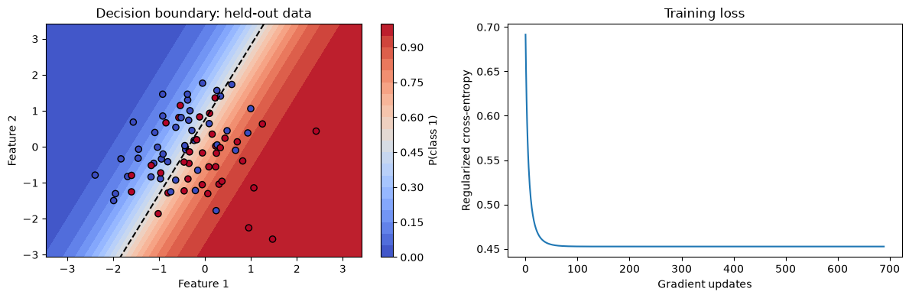

# MiniLearn

Core machine learning algorithms implemented with NumPy, with explained math,
notebook demos, and tests against scikit-learn. Built for students learning the
derivations and recruiters reviewing the implementation.


## Quick start

Requires Python 3.12 or newer. NumPy is the only library runtime dependency.

```bash
python -m venv .venv
source .venv/bin/activate
python -m pip install -e '.[dev]'
```

```python
import numpy as np
from minilearn import LinearRegression

X = np.array([[0.0], [1.0], [2.0], [3.0]])
y = np.array([1.0, 3.0, 5.0, 7.0])
model = LinearRegression().fit(X, y)
print(model.coef_, model.intercept_)  # [2.] 1.0 (up to floating-point rounding)
print(model.predict([[4.0]]))  # [9.]
```

For full-batch gradient descent, use `solver="gd"`, standardize training features
with `minilearn.utils.StandardScaler`, and choose an appropriate `learning_rate`.
Set `alpha>0` to enable ridge, using the same penalty convention as scikit-learn.
Use `random_state` for reproducible initial coefficients. The API supports
single-output regression; learned attributes end with `_`.

## Algorithm status

| Algorithm | Status | Math | Notebook |
| --- | --- | --- | --- |
| Linear regression: least squares, gradient descent, L2 | Implemented | [Derivation](docs/linear_regression.md) | [Demo](notebooks/01_linear_regression.ipynb) |
| Binary logistic regression: gradient descent, L2 | Implemented | [Derivation](docs/logistic_regression.md) | [Demo](notebooks/02_logistic_regression.ipynb) |
| k-means with k-means++ | Next | — | — |
| PCA via SVD | Planned | — | — |
| Decision tree classifier | Planned | — | — |
| MLP with backpropagation and mini-batch SGD | Planned | — | — |

Shared utilities include input validation, seeded train/test splitting, and
standard scaling. Metrics include MSE, RMSE, R², accuracy, precision, recall, and F1.
Binary precision/recall/F1 use positive label 1 and return 0 for undefined ratios.

## Binary classification

```python
import numpy as np
from minilearn import LogisticRegression

X = np.array([[-2.0], [-1.0], [1.0], [2.0]])
y = np.array([0, 0, 1, 1])
classifier = LogisticRegression(alpha=1.0, learning_rate=0.5, random_state=42).fit(X, y)
print(classifier.predict([[-1.5], [1.5]]))  # [0 1]
print(classifier.predict_proba([[0.0]]))  # Columns: P(class 0), P(class 1)
```

Training requires finite 2D features and 1D labels containing both 0 and 1.
The loss is stable binary cross-entropy plus `alpha * ||coef||² / (2*n_samples)`;
the intercept is unpenalized. `alpha>0` matches scikit-learn's `C=1/alpha`.
`loss_history_` records the initial loss and each gradient update; `converged_`
reports whether the gradient tolerance was met. Standardize features before
training, using training statistics only. See the
[math note](docs/logistic_regression.md) for stability and convergence details.



## Validation and demo

```bash
python -m pytest
ruff check .
ruff format --check .
python -m build
jupyter nbconvert --to notebook --execute notebooks/*.ipynb \
  --output-dir /tmp --ExecutePreprocessor.timeout=120
```

The notebooks plot fitted lines or a decision boundary alongside the optimization
loss and print comparisons against scikit-learn. Generated data need no downloads.

Seeded notebook results (160 generated samples, 20% held out):

| Solver | L2 alpha | Test MSE | Test R² | Max coefficient difference vs. scikit-learn |
| --- | --- | --- | --- | --- |
| Least squares | 0 | 0.240614 | 0.981088 | `8.882e-16` |
| Gradient descent | 0 | 0.240614 | 0.981088 | `9.264e-11` |
| Least squares | 2.5 | 0.224650 | 0.982343 | `8.882e-16` |
| Gradient descent | 2.5 | 0.224650 | 0.982343 | `9.377e-11` |

Seeded logistic notebook results (400 generated samples, 20% held out, `alpha=1`):

| Model | Accuracy | Precision | Recall | F1 | Cross-entropy |
| --- | --- | --- | --- | --- | --- |
| MiniLearn | 0.712500 | 0.666667 | 0.756757 | 0.708861 | 0.594511 |
| scikit-learn | 0.712500 | 0.666667 | 0.756757 | 0.708861 | 0.594511 |

Labels are sampled from a Bernoulli distribution, so classes intentionally overlap.
Maximum coefficient difference in this demo: `2.218e-9`.

| Comparison | Acceptance criterion |
| --- | --- |
| Both solvers vs. ordinary least squares | Coefficients and held-out predictions within `1e-8` absolute tolerance |
| Both solvers vs. Ridge, `alpha=2.5` | Coefficients and held-out predictions within `1e-8` absolute tolerance |
| Intercept on/off | R² within `1e-10` absolute tolerance |
| Rank-deficient and underdetermined designs | Least-squares results within `1e-10` absolute tolerance |
| Logistic regression vs. scikit-learn, L2 and intercept on/off | Coefficients within `1e-6`, probabilities within `1e-7`, identical held-out labels and accuracy |
| Logistic analytical gradient vs. central differences | Coefficient derivatives within `1e-9` absolute / `1e-7` relative tolerance; intercept within `1e-9` absolute tolerance |

These are reproducible correctness checks on seeded synthetic data, not speed
benchmarks or claims about generalization on real-world datasets. CI runs pytest,
Ruff, packaging, and notebook execution on every push and pull request.

## Roadmap

Add k-means next; then PCA, decision trees, and the MLP (including numerical
gradient checks) in separate feature branches and PRs. Later:
k-NN, naive Bayes, random forests, Adam, and decision tree regression.

See [contributing](CONTRIBUTING.md) for development conventions. Licensed under
the [MIT License](LICENSE). scikit-learn is used only in tests and notebooks.
